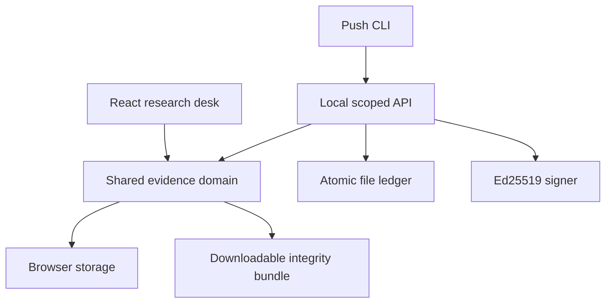

# Evidraft Lab

Research writing with immutable experiment evidence and deterministic numeric claim checks.

PAPERLOOM project · **working prototype, not a completed production collaboration platform**.

## What works

- A typeset manuscript with interactive evidence bindings, stale-run detection and deliberate rebinding.
- An append-only run ledger with strict JSON / CSV imports, content-addressed SHA-256 identity, duplicate suppression and run comparison.
- A deterministic checker distinguishing relative percentage changes, percentage points, unsupported percentages and ambiguous comparisons.
- Frozen document/evidence bundles, independent integrity verification, Markdown / LaTeX exports, print styles and browser-local persistence.
- A separate single-owner local API with scoped tokens, serialized atomic-file persistence, an import CLI and Ed25519-signed freezes.

All seeded research results are synthetic. The browser app operates on this device; it does not synchronize with the API or another user.

## Why this exists

Evidence changes faster than manuscripts. This workspace makes the exact source of a number inspectable and makes updates deliberate. Quarto and Manubot already address reproducible publishing; experiment trackers already preserve runs. We do not claim the components are novel or that this replaces them. See [prior art](docs/PRIOR_ART.md).

## Architecture



## Run

Requires Node 22.19+ and npm.

```sh
npm ci
npm run dev
npm run test
npm run build
```

For the local API, set distinct random `PUSH_TOKEN` and `READ_TOKEN` values (at least 32 characters) in your shell, then `npm run api`. It binds loopback only. `npm run push-run -- results.json` imports a run; `npm run verify -- bundle.json trusted-public-key.pem` verifies a signed bundle against a separately trusted key. An embedded key is not an identity trust anchor.

## Verification

See [EVIDENCE.md](docs/EVIDENCE.md) for exact observed results and limitations. No benchmark, model accuracy, accessibility conformance, or production-readiness claims are implied by passing domain tests.

## Honest limits

No Yjs co-editing, MongoDB, accounts/roles, share links, real model integration, rich-text/math editor, ZIP bundle, or managed backup. Local API and browser storage are separate. JSON bundles are supported. Browser freezes are unsigned. Browser storage may be cleared. Hash integrity does not prove scientific validity. [Remaining work](docs/REMAINING_WORK.md) is the release checklist.

## AI assistance

Built with Codex under human direction. The human provided the product brief, free-tier constraints and design goals. Codex authored the implementation, checks and documentation. Human review is still required before production use or resume claims beyond the recorded evidence.

MIT licensed.
